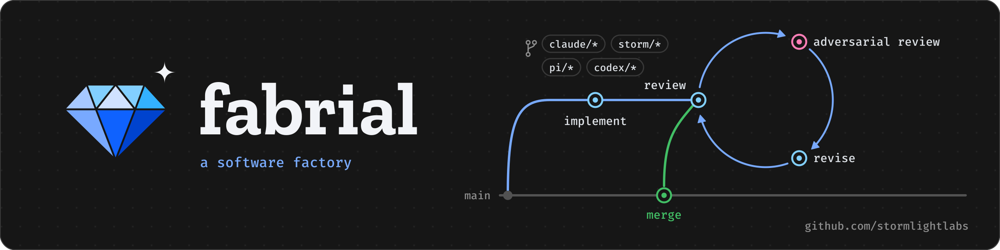

A software factory that takes ready tasks through implement, review,
adversarial review and revise until a pull request is ready to merge. See
[PLAN.md](PLAN.md).

## Install in a repository

Install a release of `fab`, then run it at the root of the repository that
should use fabrial:

```sh
curl --proto '=https' --tlsv1.2 -LsSf \
  https://github.com/stormlightlabs/fabrial/releases/latest/download/fab-cli-installer.sh | sh
fab init --owner <github-login> --trailer "Name <email>" --gates "<gate command>"
```

The installer fetches the prebuilt `fab` for Linux x86_64 or Apple Silicon
into `~/.cargo/bin`. With Homebrew on those two platforms,
`brew install stormlightlabs/tap/fab` installs the same build, from releases
after v0.7.0. `cargo binstall --git
https://github.com/stormlightlabs/fabrial fab-cli` fetches the same archives.
On another platform, build it:
`cargo install --git https://github.com/stormlightlabs/fabrial --tag v<version> fab-cli`.

It writes the Branch PR, Review gate and Bot comment workflows, the action
that installs `fab` for them, the review stages in
`.github/fabrial-sequence.toml`, `shot.sh` and its `sgr.pl`, `CODEOWNERS`,
`.github/fabrial.toml`, the skills and agents, and a section of `AGENTS.md`.
Branch PR and the Review gate install the `fab` release that
`.github/fabrial.toml` names and run `fab branch-pr` and `fab gate`. Commit
the result on a `claude/` branch and push it; the Branch PR workflow opens the
pull request.

To take a newer release, install that `fab` and run `fab update`. It keeps the
settings in `.github/fabrial.toml`, unless `--owner`, `--trailer` or `--gates`
changes one, and replaces the files with this build's. It refuses to install
an older release over a newer one unless you pass `--force`. It leaves files
that only older releases wrote, such as `.github/storm/gate.sh` and
`.github/storm/squash-body.sh`; delete them. `CHANGELOG.md` says what each
release changes.

`fab check` lists files that differ from this build's and an installed version
that differs from it, and exits 1 when there is any drift.

Before the first pull request there, install stormlight-thunderbot on the
repository and share its `THUNDERBOT_APP_ID` and `THUNDERBOT_PRIVATE_KEY`
secrets with it. The gate sets each reviewed PR's squash message in one bot
status comment, and you merge it by hand or with auto-merge, if the
repository allows it. The gate
runs from `main`, so on the install pull request it does nothing: mark that
draft ready yourself, and require `storm/review` on `main` only after it
merges.

## Local Pi workers

The preview `fab dispatch` command starts fresh Pi 1.4.0 review workers in
host tmux sessions. The whole worker runs in a pinned Nix sandbox. A trusted
local issuer supplies repository-restricted GitHub App tokens, and the root
Pi package exposes the same command as an `agent` tool. Follow
[Pi host setup](docs/pi.md) before running it; a normal development shell is
not worker isolation. This feature is under active development.

## Releases

Run the Release PR workflow from the Actions tab with the new version, such as
`0.2.0`. The bot opens a pull request that sets the version, records it in
`.github/fabrial.toml` and writes the release's section of `CHANGELOG.md`, with
`Cargo.lock` to match. The section lists each commit subject since the last
tag; a squash subject ends with its pull request number. Edit the lines on the
release branch, then accept it with `/storm:ready <sha>`, since it holds no
code to review.
When it merges, the Release tag workflow tags `v<version>` on the merge commit.
The tag starts the Release workflow, which dist generates: it builds `fab` for
each target and publishes a GitHub release with the archives, the installer and
that section of the changelog. Its publish job,
`.github/workflows/publish-homebrew.yml`, then commits the `fab` formula to
stormlightlabs/homebrew-tap with a bot token minted for that repository, so the
bot must be installed there with Contents write. Change targets or installers
in `dist-workspace.toml` and run `dist generate`; `dist plan` fails while the
workflow is out of date. The Release PR and Release tag workflows need the bot
to have Contents write access. If Release tag fails, fix the cause and run
Release tag from the Actions tab with the merge commit. If the Release workflow
fails after the tag exists, re-run that run; a new Release tag run sees the tag
and does nothing. When the tagged commit itself is the cause, delete the tag,
fix `main`, and release the next version.

Any `v*` tag pushed to the repository starts the Release workflow and
publishes a release. A tag ruleset on `v*` with the owner and
stormlight-thunderbot on its bypass list keeps other writers, agents included,
from publishing one.
