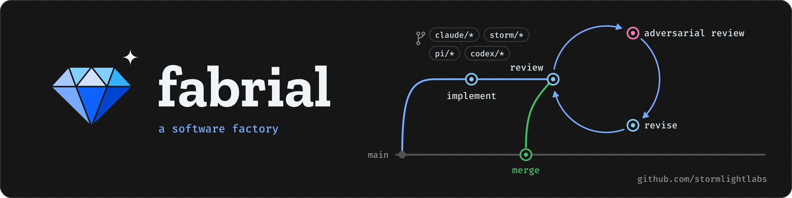

fabrial takes one task through implement, review, adversarial review and
revise, and stops at a pull request ready for a person to merge. It installs
four things into a repository: the repository contract in `AGENTS.md`, the
`fab-` skills and agent roles, the GitHub workflows, and the `fab` commands
those workflows run. It is not a harness: Claude Code, Codex or Pi runs the
agents its own way.

## Install

```sh
curl --proto '=https' --tlsv1.2 -LsSf \
  https://github.com/stormlightlabs/fabrial/releases/latest/download/fab-cli-installer.sh | sh
```

The installer puts `fab` in `~/.cargo/bin`, for Linux x86_64 or Apple
Silicon. Homebrew users can run `brew install stormlightlabs/tap/fab`.
[docs/install.md](docs/install.md) lists the other ways to get it.

## Set up a repository

1. Create a GitHub App in your account or organization, install it on the
   repository, and add its ID and key as the secrets `FABRIAL_APP_ID` and
   `FABRIAL_PRIVATE_KEY`, or under your own prefix with `--secret-prefix`.
   [docs/bot-setup.md](docs/bot-setup.md) walks
   through it, with the permissions, the ruleset on `main`, and an optional
   environment that keeps the key from branches.
2. At the repository's root, run:

   ```sh
   fab init --owner <github-login> --app <app-slug> \
     --trailer "Name <email>" --gates "<gate command>"
   ```

3. Commit the result on a `claude/` branch, push it and open its pull
   request yourself: the bot opens pull requests from `main`, which does not
   have the workflows yet. Merge it, then require the `storm/review` check
   on `main`.

Later, `fab update` installs a newer release's files and `fab check`
reports where the repository has drifted.

## One task, end to end

1. You ask an agent session for a task, with `/fab-storm <task>`.
2. The session claims the task, works it on its own branch, runs the gates
   and pushes.
3. Branch PR open opens a draft pull request as your App.
4. The session runs the review stages for the change's size, revises after
   each one, and posts `Review finished at <sha>` through the Bot comment
   workflow.
5. The Review gate turns `storm/review` green for that head, marks the pull
   request ready and posts the squash message.
6. You approve and merge.

[docs/task-flow.md](docs/task-flow.md) follows the same task step by step
and names who acts at each one.

## Settings

`.github/fabrial.toml` holds one value per line. `fab init` writes it, and
`fab update` keeps it.

| Key             | What it sets                                                                   |
| --------------- | ------------------------------------------------------------------------------ |
| `owner`         | The GitHub login that approves pull requests; `CODEOWNERS` names it.           |
| `app`           | The slug of the repository's GitHub App.                                       |
| `secret_prefix` | The prefix of the App's secrets, `<PREFIX>_APP_ID` and `<PREFIX>_PRIVATE_KEY`. |
| `environment`   | Optional: a GitHub environment, open only to `main`, that holds the secrets.   |
| `trailer`       | The `Co-authored-by` line on every squash commit.                              |
| `gates`         | The command agents run before pushing, when no gates file exists.              |
| `signoff`       | A `Signed-off-by` line to end every squash commit, for the DCO.                |
| `assisted_by`   | `on` adds an `Assisted-by` line for each agent model.                          |
| `disposable`    | Ignored paths `fab cleanup` may delete with a merged worktree.                 |
| `planning`      | Directories of planning records, reviewed like documentation.                  |
| `version`       | The fabrial release that wrote the installed files.                            |
| `[tasks]`       | The commands `fab run` uses to read, start and complete a task.                |

## The Pi harness

This repository also holds an optional Pi harness, kept as it is with no new
work. `fab dispatch` runs each role as a Pi worker in a host tmux session
inside a Nix sandbox, and `fab run` takes a task through the whole sequence
with those workers. None of the installed skills or workflows need it.
[docs/pi.md](docs/pi.md) covers it.

## Read more

- [docs/install.md](docs/install.md): what `fab init` writes, the gates
  file, naming a task tracker, and what `fab update` and `fab check` do.
- [docs/bot-setup.md](docs/bot-setup.md): the App, its secrets and the
  ruleset on `main`.
- [docs/task-flow.md](docs/task-flow.md): one task from claim to merge.
- [docs/hosts.md](docs/hosts.md): what each harness reads.
- [docs/releases.md](docs/releases.md): how fabrial itself is released.
- [PLAN.md](PLAN.md): the decisions behind fabrial.
